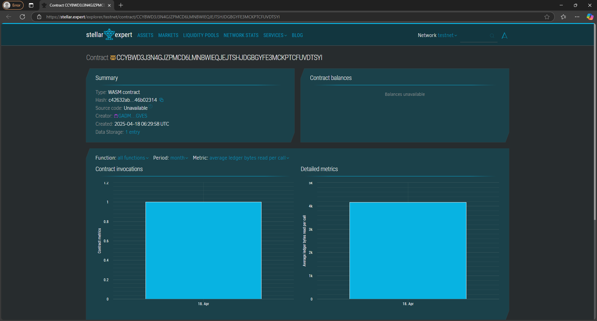

# Dividend-paying Token

## 📄 Project Title
**Dividend-paying Token on Soroban**

## 📝 Project Description
This Soroban-based smart contract implements a basic token system with dividend distribution functionality. Token holders can receive dividends based on their share of the total token supply.

## 🎯 Project Vision
Enable transparent, decentralized, and programmable dividend distribution for token holders directly on the Stellar network using Soroban smart contracts.

## 🌟 Key Features
- **Token Minting**: Create tokens and assign them to addresses.
- **Dividend Distribution**: Distribute dividends proportionally based on token holdings.
- **Holder Tracking**: View individual balances and accumulated dividends.
- **Simple State Storage**: Uses efficient on-chain mappings for token and dividend data.

## 🔮 Future Scope
- Add **token transfer** functionality.
- Support **withdrawals** of dividends to user wallets.
- Include **governance features** for configuring dividend rules.
- Add **event logging** for greater transparency.
- Introduce **access control** for mint and distribute functions.

## contract Details
CCYBWD3J3N4GJZPMCD6LMNBWIEQJEJTSHJDGBGYFE3MCKPTCFUVDTSYI
